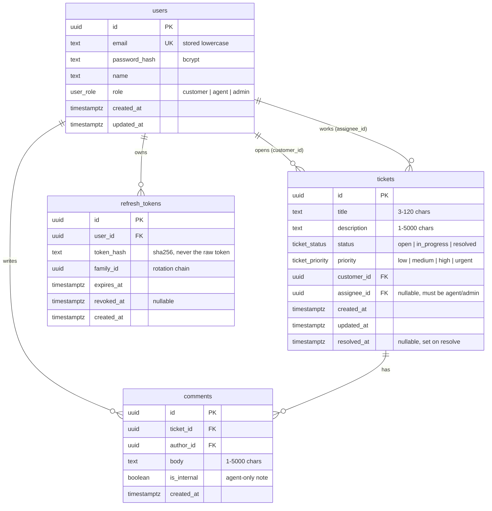
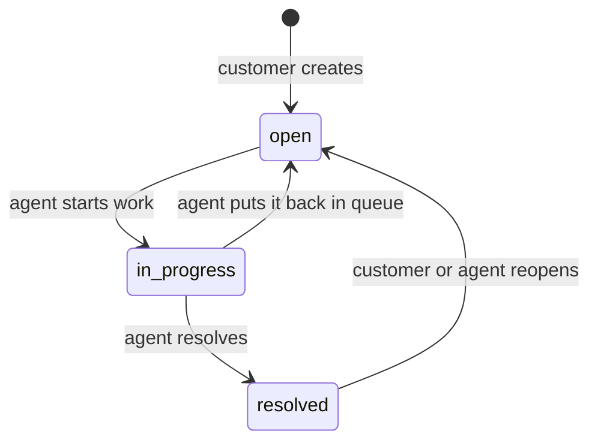

# triage-api — Design

Phase 1 of the project: what the system does, before any code.
The source of truth for the HTTP contract is [`openapi.yaml`](../openapi.yaml); this document explains the _why_ behind it.

## 1. Scope

A helpdesk backend with three kinds of users:

| Role       | What they do                                                                   |
| ---------- | ------------------------------------------------------------------------------ |
| `customer` | Opens tickets, follows their own tickets, replies to agents, reopens if needed |
| `agent`    | Works the queue: takes tickets, changes status, replies, leaves internal notes |
| `admin`    | Everything an agent can do, plus user management and metrics                   |

Out of scope for v1: attachments, email notifications, SLAs, multi-tenancy, full-text search engines.

## 2. Entities



Notes:

- **UUID primary keys**, so IDs in URLs can't be enumerated (`/tickets/1`, `/tickets/2`…).
- **`refresh_tokens` is its own table.** Access tokens are stateless JWTs (15 min); refresh tokens are opaque random strings stored only as a hash, so a database leak doesn't leak valid sessions.
- **Rotation with reuse detection:** every `/auth/refresh` revokes the used token and issues a new one in the same `family_id`. If an already-revoked token shows up again, someone copied it — the whole family is revoked.
- **`resolved_at`** is denormalized on purpose: it makes "average resolution time" a simple aggregate instead of a scan over an event log.
- Indexes planned: `tickets(customer_id)`, `tickets(assignee_id)`, `tickets(status, created_at DESC)`, `comments(ticket_id, created_at)`, `refresh_tokens(token_hash)`.

## 3. Ticket lifecycle



| From          | To            | Who                          | Side effects                    |
| ------------- | ------------- | ---------------------------- | ------------------------------- |
| `open`        | `in_progress` | agent, admin                 | assigns to caller if unassigned |
| `in_progress` | `open`        | agent, admin                 | —                               |
| `in_progress` | `resolved`    | agent, admin                 | sets `resolved_at = now()`      |
| `resolved`    | `open`        | owner customer, agent, admin | clears `resolved_at`            |

Any other transition (e.g. `open → resolved`) returns **409 `INVALID_STATUS_TRANSITION`**. Changing status to the current status is also a 409, so clients can't hide bugs behind no-op writes.

## 4. Permissions

| Action                              | customer                             | agent | admin |
| ----------------------------------- | ------------------------------------ | :---: | :---: |
| Create ticket                       | ✅                                   |   —   |   —   |
| List / read tickets                 | own only                             |  all  |  all  |
| Edit title / description / priority | own, only while `open` (no priority) |  ✅   |  ✅   |
| Change status                       | reopen own resolved ticket           |  ✅   |  ✅   |
| Assign / unassign                   | —                                    |  ✅   |  ✅   |
| Read comments                       | public ones on own tickets           |  all  |  all  |
| Write public comment                | own tickets                          |  ✅   |  ✅   |
| Write internal note                 | —                                    |  ✅   |  ✅   |
| Delete ticket                       | —                                    |   —   |  ✅   |
| List users / change roles           | —                                    |   —   |  ✅   |
| Metrics                             | —                                    |   —   |  ✅   |

Two rules worth calling out:

- **A customer asking for someone else's ticket gets 404, not 403.** A 403 would confirm the ticket exists.
- **401 vs 403 is strict:** 401 = "I don't know who you are" (missing, malformed or expired token); 403 = "I know who you are and you can't do this".

Customers can't set priority; they get `medium` by default and agents triage it.

## 5. Endpoints

Base path: `/api/v1`. All bodies are JSON. Field names are `camelCase` in the API and `snake_case` in the database.

| Method | Path                           | Auth                           | Success          |
| ------ | ------------------------------ | ------------------------------ | ---------------- |
| GET    | `/health`                      | public                         | 200              |
| GET    | `/health/ready`                | public                         | 200 / 503        |
| POST   | `/auth/register`               | public                         | 201              |
| POST   | `/auth/login`                  | public                         | 200              |
| POST   | `/auth/refresh`                | public (refresh token in body) | 200              |
| POST   | `/auth/logout`                 | public (refresh token in body) | 204              |
| GET    | `/users/me`                    | any role                       | 200              |
| GET    | `/users`                       | admin                          | 200              |
| PATCH  | `/users/{userId}/role`         | admin                          | 200              |
| POST   | `/tickets`                     | customer                       | 201 + `Location` |
| GET    | `/tickets`                     | any role                       | 200              |
| GET    | `/tickets/{ticketId}`          | any role*                      | 200              |
| PATCH  | `/tickets/{ticketId}`          | any role*                      | 200              |
| DELETE | `/tickets/{ticketId}`          | admin                          | 204              |
| POST   | `/tickets/{ticketId}/status`   | any role*                      | 200              |
| PUT    | `/tickets/{ticketId}/assignee` | agent, admin                   | 200              |
| GET    | `/tickets/{ticketId}/comments` | any role*                      | 200              |
| POST   | `/tickets/{ticketId}/comments` | any role*                      | 201              |
| GET    | `/metrics/summary`             | admin                          | 200              |

\* subject to the ownership rules in §4.

Why status is its own endpoint (`POST /tickets/{id}/status`) instead of a field in `PATCH`: a status change is a **command with rules and side effects** (transition validation, `resolved_at`, auto-assign), not a plain field update. Keeping it separate keeps `PATCH` simple and makes the transition errors easy to test.

### Listing: filters, sorting, pagination

`GET /tickets?status=open&priority=high&assigneeId=me&q=login&sort=-createdAt&page=2&limit=20`

- `status`, `priority`: comma-separated lists (`status=open,in_progress`).
- `assigneeId`: a UUID, `me`, or `none` (unassigned queue).
- `q`: case-insensitive match on title (`ILIKE`). Good enough for v1.
- `sort`: `createdAt`, `updatedAt`, `priority`; prefix `-` for descending. Default `-createdAt`.
- Pagination is **offset-based**: `page` (≥1, default 1) and `limit` (1–100, default 20).

Response envelope:

```json
{
  "data": [{ "...": "..." }],
  "meta": { "page": 2, "limit": 20, "total": 134, "totalPages": 7 }
}
```

Offset pagination is simple and lets the UI jump to page N; its weakness is drift when rows are inserted while paging. Cursor pagination fixes that and is a possible v2 improvement — a good interview talking point.

### Metrics

`GET /metrics/summary?from=2026-10-01&to=2026-10-31` returns, for tickets created in the range:

- counts by status and by priority,
- average and median resolution time (hours) — `AVG`/`PERCENTILE_CONT` over `resolved_at - created_at`,
- per-agent workload: assigned, in progress, resolved,
- tickets opened per day (`date_trunc('day', created_at)` + `generate_series` so days with zero tickets still appear).

This endpoint is written in hand-written SQL on purpose.

## 6. Errors

Every error uses **RFC 9457 Problem Details** (`Content-Type: application/problem+json`):

```json
{
  "type": "https://triage-api.dev/errors/invalid-status-transition",
  "title": "Invalid status transition",
  "status": 409,
  "detail": "Cannot change status from 'open' to 'resolved'.",
  "instance": "/api/v1/tickets/3f2c.../status",
  "code": "INVALID_STATUS_TRANSITION",
  "requestId": "01JAB7Q9X2..."
}
```

Validation errors add an `errors` array, one item per field:

```json
{
  "type": "https://triage-api.dev/errors/validation",
  "title": "Validation failed",
  "status": 400,
  "code": "VALIDATION_ERROR",
  "requestId": "01JAB7Q9X2...",
  "errors": [
    { "field": "title", "message": "must be at least 3 characters" },
    { "field": "priority", "message": "must be one of low, medium, high, urgent" }
  ]
}
```

| Status | `code`                      | When                                              |
| ------ | --------------------------- | ------------------------------------------------- |
| 400    | `VALIDATION_ERROR`          | body, query or path params fail validation        |
| 401    | `UNAUTHENTICATED`           | missing or malformed `Authorization` header       |
| 401    | `TOKEN_EXPIRED`             | access token expired → client should refresh      |
| 401    | `INVALID_CREDENTIALS`       | wrong email or password (same message for both)   |
| 401    | `INVALID_REFRESH_TOKEN`     | refresh token unknown, expired, revoked or reused |
| 403    | `FORBIDDEN`                 | authenticated but role/ownership doesn't allow it |
| 404    | `NOT_FOUND`                 | resource doesn't exist _or you can't see it_      |
| 409    | `EMAIL_TAKEN`               | register with an existing email                   |
| 409    | `INVALID_STATUS_TRANSITION` | see §3                                            |
| 422    | `INVALID_ASSIGNEE`          | assignee is not an agent/admin                    |
| 429    | `RATE_LIMITED`              | too many login attempts                           |
| 500    | `INTERNAL_ERROR`            | anything unexpected — no stack trace in the body  |

### Built for debugging

- **Request IDs.** Every response carries `X-Request-Id`. If the client sends one, it's reused; otherwise the server generates it. The same ID appears in the error body and in every log line for that request, so a user report ("I got a 409 at 3:14") maps to one grep.
- **Structured logs** (JSON, via `pino`): method, path, status, duration, user id, request id. Never passwords or tokens.
- **Stable `code` values** so clients branch on `code`, not on `detail` text.
- **`TOKEN_EXPIRED` separate from `UNAUTHENTICATED`** so a frontend knows when to refresh silently vs. send the user to login.
- **`/health/ready`** checks the database connection, so a load balancer (and you) can tell "app is up but DB is down" apart from "app is down".
